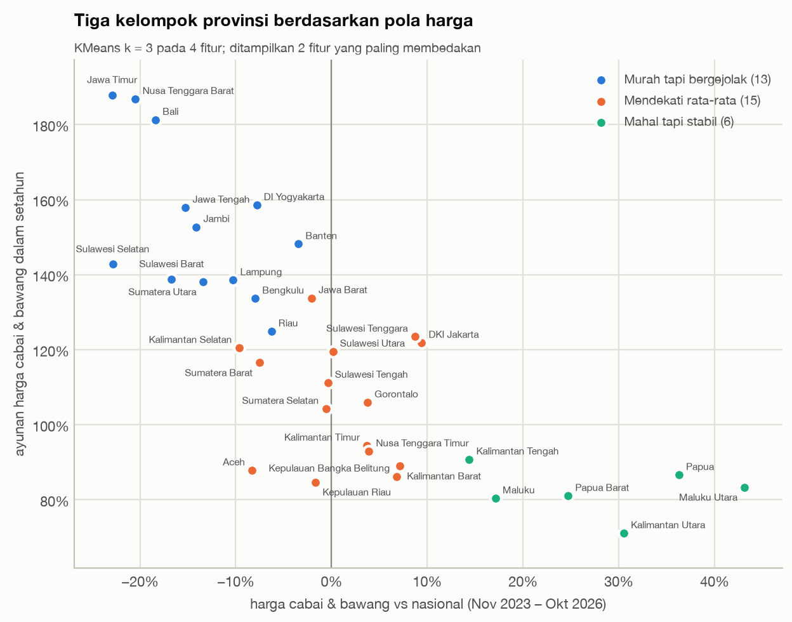

# Peta Harga Pangan Indonesia

Analisis harga pangan strategis Indonesia 2018–2026: rantai pasok, disparitas wilayah, dan pola musiman. Data berasal dari [PIHPS Nasional (Bank Indonesia)](https://www.bi.go.id/hargapangan).

📊 **Dashboard:** [Peta Harga Pangan Indonesia di Tableau Public](https://public.tableau.com/app/profile/moh.hasbi.alfarizi/viz/peta_harga_pangan/1Monitorharga).

## Temuan utama

- **Cabai rawit merah** berayun rata-rata **102%** dalam setahun. Beras dan daging sapi di bawah 7%.
- **September–Oktober** adalah bulan termurah untuk hampir semua komoditas segar. Tapi pada Oktober 2026, harga cabai justru di rekor tertinggi (2,3× rata-rata 2018).
- **Lonjakan menjelang Lebaran kecil.** Daging sapi naik di 9 dari 9 Lebaran, tapi hanya 2–3% di atas kenaikan normal, dan baru tajam sekitar H-10.
- **Akhir tahun lebih berisiko.** Menjelang Natal, cabai rawit naik 39%, bawang merah 30%, dan telur 10%.
- **Harga di Jawa adalah indikator dini.** Kenaikan di sentra Jawa diikuti provinsi luar Jawa dalam 1–2 minggu (2–4% untuk setiap 10% kenaikan). Setelah minggu dengan kenaikan 10% tertinggi di sentra Jawa, cabai rawit merah di luar Jawa naik rata-rata 11,6% minggu berikutnya.
- **Papua +25,6%** di atas rata-rata nasional. Maluku & Papua lebih mahal dari nasional di 9 dari 9 tahun.
- Harga cabai, bawang merah, dan ayam di pasar tradisional **19–29% di atas pedagang besar**.
- Pasar modern **46–72% lebih mahal untuk cabai**, tapi setara atau lebih murah untuk beras, minyak goreng kemasan, dan gula.
- Provinsi terbagi menjadi **3 kelompok**: *murah tapi bergejolak* (sentra produksi), *mendekati rata-rata*, dan *mahal tapi stabil*.



Penjelasan dan rekomendasinya ada di [docs/03_analisis_sql.md](docs/03_analisis_sql.md) (SQL), [docs/04_analisis_python.md](docs/04_analisis_python.md) (Python), dan [docs/05_dashboard_tableau.md](docs/05_dashboard_tableau.md) (dashboard).

## Pertanyaan utama

1. Komoditas mana yang paling volatil?
2. Provinsi mana yang paling mahal dibanding rata-rata nasional?
3. Berapa selisih harga dari produsen sampai ke pasar?
4. Seberapa besar dan kapan lonjakan harga menjelang hari besar?
5. Bulan apa harga termurah dan termahal?
6. Lebih murah di pasar modern atau pasar tradisional?
7. Apakah kenaikan harga di satu provinsi diikuti provinsi lain?
8. Bisakah provinsi dikelompokkan berdasarkan pola harganya?

Detail lengkap ada di [docs/01_problem_definition.md](docs/01_problem_definition.md).

## Tech stack

| Tool | Peran |
|---|---|
| **PostgreSQL** | Load data, cleaning, data modeling (star schema), query analisis |
| **Python** | Pengambilan data, EDA, uji statistik, clustering |
| **Tableau Public** | Dashboard interaktif |

## Alur data

```
PIHPS (BI) + BPS → data/raw → PostgreSQL (raw → staging → mart)
                                   ├─→ Python: EDA, statistik, clustering
                                   └─→ data/exports (CSV + Excel) → Tableau Public
```

## Cara menjalankan

Kebutuhan: [uv](https://docs.astral.sh/uv/) dan PostgreSQL 17.

```bash
uv sync                                                    # install library Python
createdb harga_pangan                                      # buat database
uv run python src/fetch_pihps.py --start 2018-01 --price-types 1        # pasar tradisional (~75 menit)
uv run python src/fetch_pihps.py --start 2023-01 --price-types 2 3 4    # modern, pedagang besar, produsen (~2 jam)
uv run python src/load_raw.py                              # load ke schema raw
uv run python src/build_warehouse.py                       # bangun staging + mart, jalankan quality checks
uv run jupyter nbconvert --to notebook --execute --inplace notebooks/*.ipynb   # jalankan notebook analisis
uv run python src/export_tableau.py                        # ekspor CSV + Excel untuk Tableau, cek hasilnya
```

Penjelasan pipeline, star schema, dan keputusan cleaning ada di [docs/02_data_model.md](docs/02_data_model.md).

Koneksi database bisa diatur lewat environment variable `DATABASE_URL` (default: `postgresql://localhost/harga_pangan`).

## Struktur folder

```
├── data/
│   ├── raw/          # snapshot data mentah (tidak di-commit)
│   ├── interim/      # hasil antara (tidak di-commit)
│   ├── reference/    # data referensi kecil (koordinat provinsi)
│   └── exports/      # CSV final dan dashboard_pangan.xlsx untuk Tableau
├── docs/             # dokumentasi proyek
├── sql/              # schema, staging, mart, quality checks, view ekspor
│   └── analysis/     # satu query per pertanyaan bisnis
├── notebooks/        # EDA, uji hipotesis, lead-lag, clustering
├── src/              # script Python (pengambilan data, load, helper notebook)
├── tableau/          # palet warna (Preferences.tps) dan workbook Tableau (.twbx)
└── reports/figures/  # grafik untuk README
```
