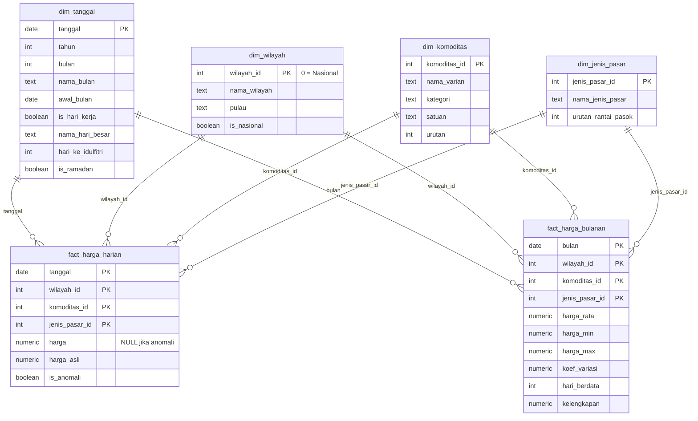

# Fase 2 — Data Pipeline & Model Data

## Alur data (ELT)

```
PIHPS (JSON)  ──fetch_pihps.py──>  data/raw/pihps/*.json  ──load_raw.py──>  raw  ──02_staging.sql──>  staging  ──03_marts.sql──>  mart
                                                                                                                                  │
                                                                                                        04_quality_checks.sql ◄───┘
```

| Lapisan | Isi | Dibuat oleh |
|---|---|---|
| `data/raw/` | Snapshot JSON persis dari API, satu file per jenis pasar × wilayah × bulan | [`src/fetch_pihps.py`](../src/fetch_pihps.py) |
| schema `raw` | Snapshot dimuat apa adanya. Harga masih berformat wide (jsonb) dan bertipe teks | [`src/load_raw.py`](../src/load_raw.py), [`sql/01_schema.sql`](../sql/01_schema.sql) |
| schema `staging` | Unpivot, konversi tipe, mapping kode, penandaan anomali | [`sql/02_staging.sql`](../sql/02_staging.sql) |
| schema `mart` | Star schema siap analisis dan dashboard | [`sql/03_marts.sql`](../sql/03_marts.sql) |

Python hanya bertugas **mengambil dan memuat** data (Extract & Load). Semua **transformasi** dilakukan di SQL, supaya logika cleaning terdokumentasi dan bisa diaudit di satu tempat.

## Star schema



**Grain:**
- `fact_harga_harian`: satu harga per tanggal × wilayah × varian × jenis pasar. Hanya hari yang ada datanya.
- `fact_harga_bulanan`: agregat bulanan dari tabel harian. Dipakai untuk tren dan sebagai sumber data Tableau.

**Cakupan data** (per 30 Okt 2026):

| Jenis pasar | Periode | Baris harian | Wilayah |
|---|---|---|---|
| Pasar Tradisional | Jan 2018 – Okt 2026 | 1.587.593 | 35 |
| Pasar Modern | Jan 2023 – Okt 2026 | 641.761 | 35 |
| Pedagang Besar | Jan 2023 – Okt 2026 | 690.051 | 35 |
| Produsen | Jan 2023 – Okt 2026 | 431.031 | 34 |

Jenis pasar selain pasar tradisional hanya diambil mulai 2023 supaya pengambilan data tidak terlalu lama (±2 jam). Itu cukup untuk perbandingan 12 bulan terakhir di Q3 dan Q6. Harga produsen tidak tersedia untuk semua varian di semua provinsi.

## Keputusan cleaning

| Masalah di data sumber | Keputusan | Alasan |
|---|---|---|
| Harga tersimpan per tanggal sebagai kolom (wide) | Unpivot dengan `jsonb_each_text` | Format long dibutuhkan untuk agregasi dan join |
| Harga berupa teks `"11,050"`, kosong ditulis `"-"` | Hapus koma, `'-'` → `NULL`, cast ke `numeric` | — |
| Baris kategori ("Beras") tercampur dengan varian ("Beras Kualitas Medium I") | Hanya varian (level 2) yang dipakai; kategori jadi atribut di `dim_komoditas` | Mencegah harga terhitung ganda |
| Rata-rata nasional disimpan dengan `province_id` kosong | Diberi `wilayah_id = 0` ("Nasional") | Key tidak boleh NULL |
| Lonjakan satu-dua hari yang langsung kembali normal, mis. telur nasional Rp53.250 pada Iduladha 2020 (hari sekitarnya ~Rp26.300) | Ditandai `is_anomali` kalau menyimpang > 25% dari rata-rata 5 hari sebelum **dan** sesudahnya, searah. Harga asli tetap disimpan | Ambang dipilih setelah membandingkan 20/25/30/40%. Tren yang bertahan tidak ikut tertandai. Hasilnya 995 sel (0,030%), 702 di antaranya di pasar tradisional |
| Tanggal hari besar tidak ada di data | Tabel referensi manual di `staging.stg_hari_besar` (versi pemerintah) | Dibutuhkan untuk analisis musiman |

## Quality checks

[`sql/04_quality_checks.sql`](../sql/04_quality_checks.sql) dijalankan setiap kali build. Build dianggap gagal kalau ada check yang tidak lolos.

| # | Pemeriksaan | Hasil (1 Nov 2026, 4 jenis pasar) |
|---|---|---|
| 1 | Rekonsiliasi jumlah sel terisi raw = baris fact | ✅ 3.350.436 = 3.350.436 |
| 2 | Semua varian di raw terpetakan | ✅ |
| 3 | Semua wilayah di raw terpetakan | ✅ |
| 4 | Tidak ada harga ≤ 0 | ✅ |
| 5 | Tidak ada data di akhir pekan | ✅ |
| 6 | Proporsi anomali < 0,1% | ✅ 0,030% |
| 7 | Setiap wilayah × bulan punya data pasar tradisional | ✅ |
| 8 | Setiap provinsi punya kelompok pulau | ✅ |
| 9 | Rata-rata bulanan berada di antara min dan max | ✅ |
| 10 | Setiap tahun punya tanggal Idulfitri | ✅ |

## Cara membangun ulang

```bash
uv run python src/load_raw.py          # raw (dari data/raw)
uv run python src/build_warehouse.py   # staging + mart + quality checks (~50 detik)
```
