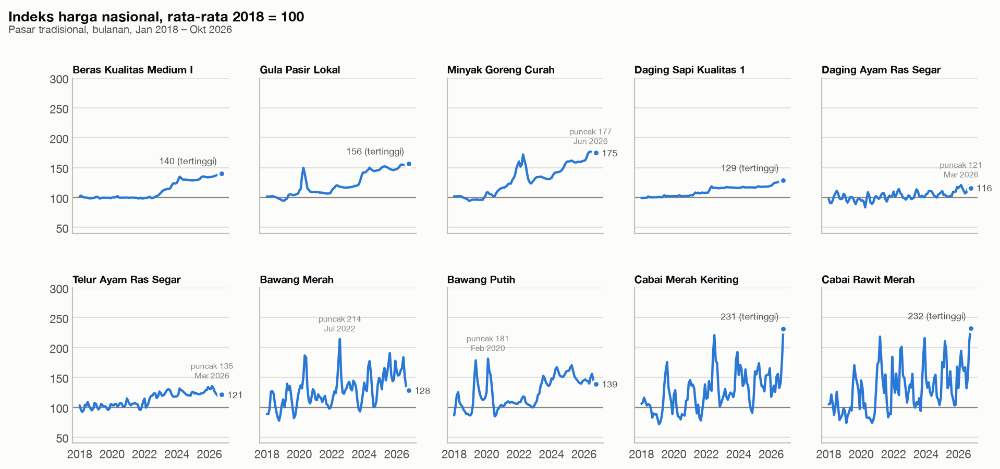
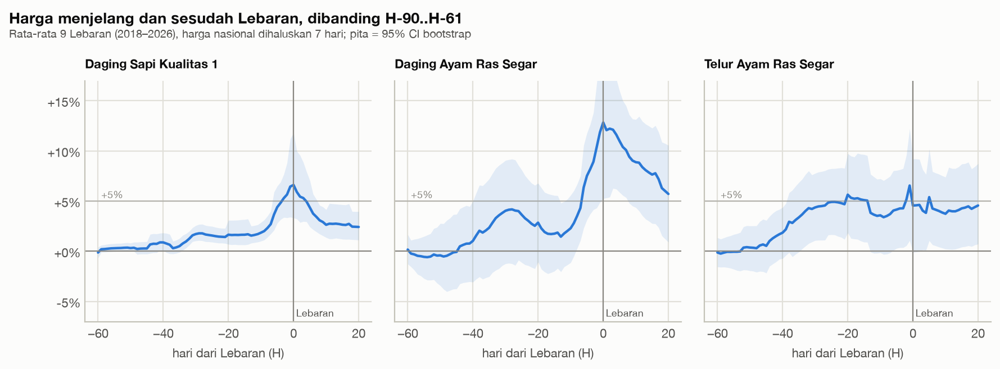
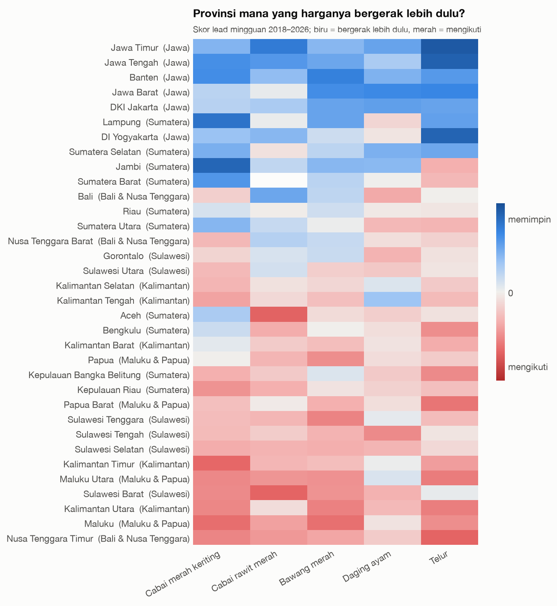
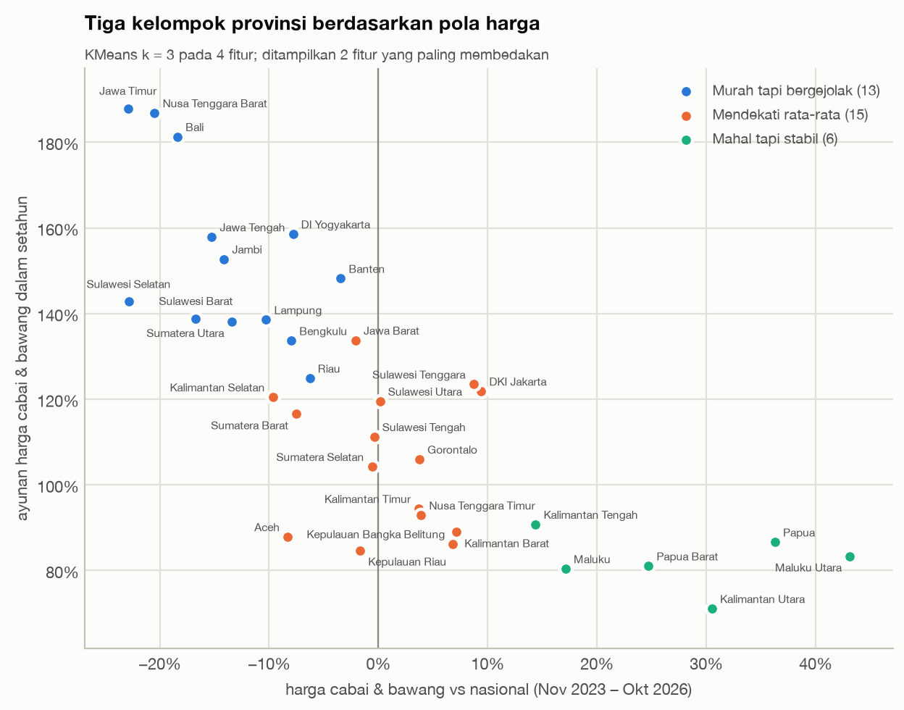

# Fase 4 — Analisis Python: EDA, uji statistik, lead-lag, clustering

Fase 3 menjawab Q1–Q6 secara deskriptif dengan SQL. Fase 4 memakai Python untuk tiga hal yang sulit dilakukan di SQL:

1. menguji apakah polanya cukup kuat secara statistik,
2. melihat hubungan antarprovinsi dari waktu ke waktu (Q7), dan
3. mengelompokkan provinsi (Q8).

| Notebook | Isi | Menjawab |
|---|---|---|
| [`01_eda.ipynb`](../notebooks/01_eda.ipynb) | Kelengkapan data, tren 2018–2026, sebaran perubahan bulanan, korelasi antarkomoditas, contoh anomali | Q1, kualitas data |
| [`02_uji_hipotesis.ipynb`](../notebooks/02_uji_hipotesis.ipynb) | Uji statistik H1–H5, kurva harga sekitar Lebaran, perbandingan dengan Nataru | H1–H5, Q4 |
| [`03_lead_lag_provinsi.ipynb`](../notebooks/03_lead_lag_provinsi.ipynb) | Skor lead, uji Granger, profil jeda harian, pass-through | Q7 |
| [`04_clustering_provinsi.ipynb`](../notebooks/04_clustering_provinsi.ipynb) | Fitur provinsi, pemilihan k, profil cluster, ekspor untuk Tableau | Q8 |

Semua notebook membaca data dari tabel `mart` lewat [`src/db.py`](../src/db.py). Gaya grafiknya diatur di [`src/viz.py`](../src/viz.py), dan semua grafik disimpan ke `reports/figures/`.

## Ringkasan untuk manajemen

Temuan baru dari Fase 4, sebagai tambahan dari [ringkasan Fase 3](03_analisis_sql.md):

1. **Akhir tahun lebih berisiko daripada Lebaran.** Menjelang Natal, harga cabai rawit merah naik 39%, bawang merah 30%, dan telur 10%. Bawang merah dan telur naik di 8 dari 8 tahun. Menjelang Lebaran, kenaikannya hanya 2–6% di atas kenaikan normal.
2. **Harga di Jawa adalah indikator dini.** Kenaikan harga di Jawa Barat, Jawa Tengah, dan Jawa Timur diikuti provinsi luar Jawa dalam 1–2 minggu. Setiap kenaikan 10% di Jawa diikuti kenaikan tambahan 2–4% di luar Jawa pada minggu berikutnya.
3. **Provinsi terbagi menjadi tiga kelompok**, masing-masing butuh strategi procurement berbeda: *murah tapi bergejolak* (sentra produksi), *mendekati rata-rata*, dan *mahal tapi stabil* (Maluku, Papua, Kalimantan Tengah & Utara).
4. **Provinsi yang lebih murah, harganya lebih bergejolak** (korelasi −0,78). Outlet di sentra produksi menikmati harga rendah, tapi menanggung ayunan harga cabai dan bawang sekitar 150% per tahun.
5. **Cabai sedang di rekor tertinggi.** Pada Oktober 2026, harga cabai 2,3× rata-rata 2018. Biasanya September–Oktober justru bulan termurah.

## 1. EDA



- Data pasar tradisional **94% lengkap**. Gorontalo paling rendah (71–78%) karena hanya ~15 dari 21 varian dilaporkan. Karena itu, perbandingan antarprovinsi selalu memakai indeks per varian, bukan total keranjang.
- **Komoditas pokok naik bertahap dan tidak turun lagi.** Pada Oktober 2026, beras (indeks 140), gula (156), dan daging sapi (129) ada di titik tertingginya.
- **Perubahan bulanan cabai dan bawang merah tersebar selebar 15–27 poin persen** (50% bulan di tengah). Beras dan daging sapi hanya ±1%. Harga cabai rawit naik lebih dari 10% dalam sebulan di 34 dari 105 bulan.
- Varian dalam satu kategori bergerak hampir identik (median r = 0,92). Antarkategori hampir independen (median r = 0,05), kecuali **cabai merah dan cabai rawit** (r = 0,6–0,7). Artinya, mengganti cabai merah dengan cabai rawit di menu tidak mengurangi risiko harga.

## 2. Uji hipotesis

Prinsip yang dipakai:
- **Unit yang kira-kira independen.** Yang diuji adalah provinsi, tahun, atau peristiwa Lebaran, bukan jutaan baris harian yang saling berkorelasi.
- **Uji non-parametrik.** Unitnya sedikit (5–34) dan sebarannya miring.
- **Ukuran efek selalu dilaporkan**, bersama interval kepercayaan bootstrap.
- **Koreksi Holm** setiap kali ada banyak uji sekaligus.

Untuk H4 ada satu tambahan, yaitu **uji plasebo**. Harga cenderung naik pelan sepanjang tahun, jadi yang diuji adalah kelebihan kenaikan menjelang Lebaran di atas kenaikan "normal". Kenaikan normal dihitung dari jendela waktu yang sama di 1.340 tanggal yang jauh dari Lebaran.

**Status hipotesis final** (menggantikan tabel di [docs/03](03_analisis_sql.md)):

| Hipotesis | Uji | Hasil | Keputusan |
|---|---|---|---|
| H1: cabai & bawang merah paling volatil, beras & gula paling stabil | Wilcoxon berpasangan, 34 provinsi | Ayunan cabai & bawang 11× lebih besar daripada beras & gula, di 34 dari 34 provinsi (p < 0,001). Tapi yang paling stabil justru **daging sapi** (5%), lalu beras (8%) dan gula (11%) | ✅ Diterima, dengan koreksi |
| H2: Indonesia Timur (Maluku, Papua, NTT) konsisten lebih mahal | Uji tanda per provinsi (9 tahun), Mann-Whitney | Maluku, Maluku Utara, Papua, Papua Barat di atas nasional 9 dari 9 tahun (p = 0,002). NTT hanya +3%. Kalimantan juga selalu di atas nasional | ⚠️ Sebagian |
| H3: selisih produsen → pasar terbesar di komoditas mudah rusak | Wilcoxon berpasangan, 31 provinsi | Cabai & bawang merah 56% vs komoditas tahan simpan 14%, di 28 dari 31 provinsi (p < 0,001). Telur (13%) dan daging sapi (10%) tidak ikut pola ini | ✅ Diterima untuk cabai & bawang |
| H4: daging, ayam, telur naik signifikan ~2 minggu sebelum Lebaran | Wilcoxon vs plasebo, 9 Lebaran | Daging sapi naik di 9 dari 9 Lebaran, tapi hanya +2–3% di atas normal. Ayam & telur +6%, tapi hanya di 7 dari 9 Lebaran (p = 0,07). Kenaikan tajam baru mulai ~H-10 | ⚠️ Sebagian |
| H5: pasar modern lebih mahal untuk segar, lebih murah untuk kemasan | Wilcoxon per varian + Holm, 21 varian | 10 dari 10 varian segar lebih mahal (+5% s.d. +72%). Kemasan: 9 dari 11 setara, hanya gula yang lebih murah (−3% s.d. −6%) | ⚠️ Sebagian |



**Rekomendasi dari H4:**
- Untuk daging sapi dan ayam, amankan harga paling lambat ~H-14 Lebaran, sebelum kenaikan tajam di H-10. Harga ayam masih +6% dua minggu setelah Lebaran.
- Risiko terbesar justru di akhir tahun. Amankan stok bawang merah dan telur sebelum Desember, dan pakai kontrak harga cabai untuk Desember–Maret.
- Catatan: temuan Nataru masih eksploratif, karena hanya 8 kejadian dan tidak lolos koreksi 21 uji. Efek Nataru juga tidak bisa dipisahkan dari awal musim hujan.

## 3. Q7 — Apakah kenaikan harga di satu provinsi diikuti provinsi lain?

**Ya. Harga di Jawa bergerak lebih dulu, dan provinsi luar Jawa mengikuti dalam 1–2 minggu.**



| Temuan | Angka |
|---|---|
| Provinsi luar Jawa yang harganya bisa diprediksi dari harga di sentra Jawa (uji Granger, Holm 5%) | 23–28 dari 28 (cabai rawit, bawang merah, ayam, telur) |
| Arah sebaliknya (luar Jawa memprediksi Jawa) | 0–6 dari 28 (cabai rawit, bawang merah, ayam) |
| Jeda | sebagian besar di hari yang sama, sisanya mengalir sampai 5–10 hari |
| Pass-through ke minggu berikutnya | 2–4% untuk setiap 10% kenaikan di Jawa |
| Stabilitas pola (skor 2018–2021 vs 2022–2026) | korelasi 0,67–0,95 |

Catatan metode:
- **Pemimpin ditentukan di awal**, yaitu rata-rata Jawa Barat, Jawa Tengah, dan Jawa Timur sebagai tiga sentra produksi terbesar. Pemimpin tidak dipilih dari data, supaya p-value tidak bias.
- **Uji Granger menunjukkan kemampuan memprediksi, bukan hubungan sebab-akibat.**
- **Ada efek data.** Provinsi yang harganya jarang diperbarui cenderung terlihat "mengikuti"; contohnya Maluku Utara, yang harganya tidak berubah di 89% hari. Di antara 16 provinsi yang datanya sering diperbarui, Jawa tetap memimpin. Tetapi seberapa jauh provinsi timur tertinggal sebagian dipengaruhi frekuensi pembaruan data.

**Rekomendasi:** jadikan harga mingguan cabai rawit, bawang merah, ayam, dan telur di sentra Jawa sebagai indikator peringatan dini di dashboard. Kalau harga di sana naik lebih dari ~10% dalam seminggu, outlet di luar Jawa punya waktu sekitar satu minggu untuk menambah stok.

## 4. Q8 — Bisakah provinsi dikelompokkan berdasarkan pola harganya?

**Ya, menjadi tiga kelompok.** Pengelompokan memakai KMeans pada 4 fitur: level harga pokok, level harga protein, level harga bumbu, dan ayunan harga cabai & bawang.



| Cluster | Provinsi | Harga bumbu vs nasional | Ayunan cabai & bawang | Strategi procurement |
|---|---|---|---|---|
| **Murah tapi bergejolak** (13) | Jawa Timur, Jawa Tengah, DIY, Banten, Bali, NTB, Sulawesi Selatan, Sulawesi Barat, Sumatera Utara, Jambi, Lampung, Bengkulu, Riau | −14% | 153%/tahun | Beli lokal, tapi kunci harga cabai & bawang lewat kontrak atau forward buying. Bisa jadi hub pasokan untuk kelompok lain |
| **Mendekati rata-rata** (15) | Jawa Barat, DKI Jakarta, Aceh, Sumatera Barat & Selatan, Kepulauan Riau, Bangka Belitung, Kalimantan Barat, Selatan & Timur, Sulawesi Utara, Tengah & Tenggara, Gorontalo, NTT | ±1% | 106%/tahun | Anggaran standar nasional; pantau indikator dini dari Jawa |
| **Mahal tapi stabil** (6) | Maluku, Maluku Utara, Papua, Papua Barat, Kalimantan Tengah, Kalimantan Utara | +28% | 82%/tahun | Anggaran premium 10–30%; fokus pada ongkos kirim dan kontrak jangka panjang dengan supplier tetap |

Pemilihan k = 3:
- Silhouette k = 3 hampir sama dengan k = 2 (0,38 vs 0,40), tetapi jauh lebih stabil. KMeans dan Ward sepakat (ARI 0,89), dan hasilnya bertahan di 200 sampel bootstrap (ARI 0,89).
- Satu dimensi utama menjelaskan 79% variansi. Jadi provinsi lebih tepat dilihat sebagai satu spektrum, dari *murah & bergejolak* ke *mahal & stabil*, yang dibagi tiga.

Hasil cluster diekspor ke [`data/exports/cluster_provinsi.csv`](../data/exports/cluster_provinsi.csv) untuk peta di Tableau.

## Keterbatasan

- **Jumlah kejadian kecil:** 9 Lebaran dan 8 Nataru. Efek di bawah ~5% sulit dibedakan dari noise.
- Efek Nataru dan awal musim hujan tidak bisa dipisahkan dengan data harga saja.
- **Lead-lag** sebagian dipengaruhi frekuensi pembaruan data di provinsi tertentu. Uji Granger juga hanya menunjukkan kemampuan memprediksi.
- **Struktur cluster sedang** (silhouette 0,38). Provinsi di perbatasan dua cluster, misalnya Jawa Barat dan Riau, bisa berpindah kalau fiturnya diubah.
- Semua analisis memakai harga survei PIHPS, bukan harga beli aktual perusahaan, dan belum memasukkan ongkos kirim.

## Cara menjalankan

```bash
uv run jupyter lab                     # buka dan jalankan notebook secara interaktif
```

```bash
uv run jupyter nbconvert --to notebook --execute --inplace notebooks/*.ipynb   # jalankan ulang semua notebook
```

Database `harga_pangan` harus sudah dibangun (lihat [docs/02](02_data_model.md)).
